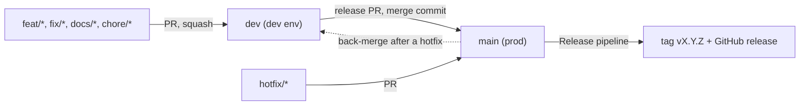

# Contributing

## Rules

- **Never commit or push to `dev` or `main`.** Branch from `dev`, open a pull request, and let CI pass.
- Branch names: `<type>/<slug>`, for example `feat/login-screen`, `fix/streak-reset`, `docs/adr-storage` or `hotfix/crash-on-start`.
- Commit messages and PR titles use [Conventional Commits](https://www.conventionalcommits.org): `feat(auth): add login screen`.
- Every PR adds a line under *Unreleased* in [CHANGELOG.md](CHANGELOG.md).

## Branches and environments



| Branch | Environment | What happens on merge |
|---|---|---|
| `dev` | dev | The Dev pipeline reruns CI and uploads a debug APK built with `APP_ENV=dev` |
| `main` | prod | The Release pipeline reruns CI, tags the version, builds with `APP_ENV=prod` and publishes a release |

## First-time setup

```bash
sh tool/setup.sh        # Windows: tool\setup.cmd
```

This enables the git hooks in `.githooks/`: no commits on `dev`/`main`, Conventional Commit messages, a secret scan (when [gitleaks](https://github.com/gitleaks/gitleaks) is installed) and a format check. It also runs `flutter pub get`.

## Before opening a PR

```bash
dart format .
flutter analyze --fatal-infos
flutter test --coverage && bash tool/coverage_check.sh
python tool/docs_index.py
```

Then fill in the PR template. The required check is **CI gate**, which summarises every CI and security job.

## Releasing

1. Actions > **Prepare release** > enter the version. Edit the changelog in the PR it opens, then merge it into `dev`.
2. Open the PR `dev` -> `main` titled `release: vX.Y.Z` and merge it with a **merge commit**.
3. The Release pipeline tags and publishes. Details are in [CI/CD](docs/architecture/ci-cd.md).

## Documentation

Update what your change affects: [architecture](docs/architecture/overview.md), a new [decision record](docs/decisions/README.md) for any non-obvious choice, and the [plan](docs/plans/README.md) checkboxes. The rules are in [.claude/rules/common/documentation.md](.claude/rules/common/documentation.md).

## Working with Claude Code

See [CLAUDE.md](CLAUDE.md). Rules live in `.claude/rules/`, agents in `.claude/agents/`, skills in `.claude/skills/`, and the commands are `/plan`, `/tdd`, `/feature`, `/verify`, `/review`, `/build-fix`, `/adr` and `/release`.
