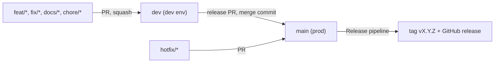

# CI/CD, environments and branch rules

Status: Current

Decisions: [ADR 0002](../decisions/0002-branching-and-ci.md), [ADR 0003](../decisions/0003-dev-and-prod-environments.md).

## Branch flow

- `dev` is the default branch and the **dev** environment. `main` is **prod**: every commit on it is a release.
- Both branches take changes only through pull requests that pass **CI gate**. This is enforced in three places: branch protection (admins included), the git hooks in `.githooks/`, and the Claude Code hooks in `.claude/hooks/`.
- Only `dev` or a `hotfix/*` branch may target `main`; the *Branch rules* job rejects anything else.
- Squash merges into `dev` turn the PR title, which must be a Conventional Commit, into the commit subject. Release PRs into `main` use a merge commit so the branches share history.

## Workflows

| Workflow | Trigger | What it does |
|---|---|---|
| `ci.yml` | PR into `dev`/`main`, merge queue, and called by the pipelines | Branch rules and PR title, `dart format`, `flutter analyze --fatal-infos`, lockfile check, `flutter test --coverage` with an 80 % gate on domain and data, repo lint (JSON/ARB, docs index, markdownlint, lychee link check, ShellCheck, actionlint), release readiness (PRs into `main`), an Android debug build (once `android/` exists) and **Security**. The final **CI gate** job is the single required check. |
| `security.yml` | Called by CI, weekly, manual | gitleaks secret scan, dependency review (PRs only), OSV-Scanner on `pubspec.lock`, CodeQL for workflows, zizmor workflow audit |
| `dev.yml` (**dev pipeline**) | Push to `dev` (a merged PR) | The full CI gate on the merged result, plus a downloadable `app-debug-apk` artifact built with `APP_ENV=dev` |
| `release.yml` (**prod pipeline**) | Push to `main` (a merged release or hotfix PR) | The full CI gate, then in the `production` environment: tag `v<version>`, build an AAB and APK with `APP_ENV=prod` (signed when the secrets exist), and publish a GitHub release with the notes from `CHANGELOG.md` |
| `prepare-release.yml` | Manual, with a version | Branches off `dev`, bumps `pubspec.yaml`, moves *Unreleased* in the changelog under the version, and opens a PR into `dev` |
| `scorecard.yml` | Push to `dev`, weekly | OpenSSF Scorecard supply-chain analysis |

Dependabot (`.github/dependabot.yml`) opens weekly grouped updates for pub packages and actions against `dev`, with a 7-day cooldown.

## Workflow hardening

- Every third-party action is pinned to a full commit SHA with a version comment. Dependabot bumps both.
- The default token is `contents: read`. Jobs that need more ask for it explicitly.
- Checkout uses `persist-credentials: false`, except in *Prepare release*, which pushes a branch.
- Untrusted values (PR titles, branch names, inputs) reach shell scripts only through `env:`.
- The release job does not use a build cache, so a poisoned cache cannot reach a release.
- actionlint, CodeQL and zizmor check every change to `.github/workflows/`.

## Releasing

1. Actions > **Prepare release** > version `X.Y.Z`. Edit the changelog in the PR it opens, then merge it into `dev`.
2. Open the PR `dev` -> `main` titled `release: vX.Y.Z`. *Release readiness* checks that the changelog has the section and that the tag is new.
3. Merge with a merge commit. The Release pipeline does the rest.

Hotfix: branch `hotfix/<slug>` from `main`, bump the patch version, add a changelog section and open a PR into `main`. After the merge, open a PR `main` -> `dev`.

## Secrets and environments

| Name | Where | Why |
|---|---|---|
| `ANDROID_KEYSTORE_BASE64`, `ANDROID_KEY_ALIAS`, `ANDROID_KEY_PASSWORD`, `ANDROID_STORE_PASSWORD` | `production` environment | Release signing. Without them the release build is unsigned (debug-signed). Your `android/app/build.gradle.kts` must read `android/key.properties`; see the [Flutter docs](https://docs.flutter.dev/deployment/android#configure-signing-in-gradle). |
| `RELEASE_BOT_TOKEN` (optional) | Repository | A fine-grained PAT. PRs opened with the default token do not trigger CI, so without it, push an empty commit to the release branch. |

Add required reviewers to the `production` environment (Settings > Environments) if you want a manual go/no-go before every release.

## Repository settings

`tool/setup_branch_protection.sh` applies them: `dev` is the default branch; squash and merge commits are allowed (no rebase); branches are deleted on merge; auto-merge is allowed; Dependabot alerts and security updates, secret scanning with push protection and private vulnerability reporting are on; `dev` and `main` are protected (CI gate required, branch up to date, conversations resolved, no force pushes or deletions, admins included).
