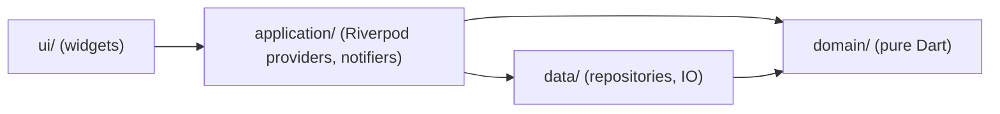

# Architecture overview

Status: Current

Replace the placeholder sections with your app once it has real features.

## Layers

- **domain** holds entities, value objects and repository *interfaces*. It has no Flutter or IO imports and is fully unit tested.
- **data** implements the domain interfaces (storage, HTTP, parsing).
- **application** wires domain and data together with Riverpod: a `Provider` per dependency and a `Notifier`/`AsyncNotifier` per piece of state.
- **ui** renders state and forwards user actions. It contains no logic.

Features live in `lib/features/<feature>/` and only depend on each other's `domain` types and `application` providers. Shared code lives in `lib/core/`: `config/` (environment), `theme/` (tokens, themes), `logging/` and `utils/` (clock).

The reasoning is in [ADR 0001](../decisions/0001-flutter-riverpod-feature-first.md).

## Features

| Feature | What it does |
|---|---|
| `counter` | Reference implementation of all four layers. Delete it when real features exist. |

## Environments

`AppEnv` (`lib/core/config/app_env.dart`) is set at build time with `--dart-define=APP_ENV=dev|prod`. Anything other than `prod` is `dev`. Non-production builds show an environment banner. See [CI/CD](ci-cd.md) and [ADR 0003](../decisions/0003-dev-and-prod-environments.md).

## Cross-cutting rules

- Time and randomness are injected (`Clock`, `Random`).
- Strings live in `lib/l10n/app_en.arb`, and visual values in `lib/core/theme/tokens.dart`.
- Logging goes through `Log`, never `print`.
